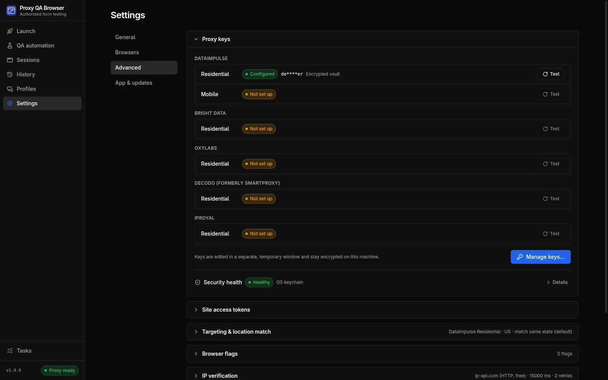

# DataImpulse proxy setup

To test your own site through a DataImpulse plan, save the plan's proxy login in Proxy QA Browser once, pick a US state, city or ZIP code on the Launch page, and the app builds the DataImpulse username parameters, checks the exit IP's location and opens the browser. DataImpulse is the provider the app is **live-tested** with. Proxy QA Browser does not sell proxies and is [not affiliated with or endorsed by DataImpulse](/docs/introduction#license).

## What you need

- A DataImpulse **Residential** or **Mobile** plan of your own. They are separate plans with separate logins on the same gateway.
- The plan's proxy **login** and **password** from your DataImpulse dashboard. Enter the bare login; the app adds every targeting parameter itself.
- Proxy QA Browser for [Windows, Linux or macOS](/download).

## Set up DataImpulse in the app

1. Open **Manage keys** on the Launch page (or **Settings → Advanced → Proxy keys → Manage keys…**) and choose the provider **DataImpulse**.
2. Pick the product tab, **Residential** or **Mobile**. **Proxy host** and **Port** are pre-filled with the gateway `gw.dataimpulse.com:823`.
3. Enter the login and password, click **Test connection** (one request through the proxy, nothing saved), then **Save encrypted**.



The login is stored in the [encrypted vault](/docs/security-and-privacy) and never shown in previews, logs or run history. A Residential login is never used for the Mobile pool. The same steps are part of the [first-run wizard](/docs/first-run).

## Target a US state, city or ZIP code

On the Launch page, choose **DataImpulse** as the **Proxy provider**, a pool, and an **Exit location**. The app appends the parameters after a double underscore, `key.value` pairs separated by `;`:

| Target | Parameters added to the login |
| --- | --- |
| Country | `__cr.us` |
| State | `__cr.us;state.newjersey` |
| City | `__cr.us;state.newjersey;city.newark` |
| ZIP code | `__cr.us;state.newjersey;city.newark;zip.07102` |

Place names are lower case with spaces removed (`newjersey`, `stlouis`), as in DataImpulse's published state list. The **Will connect as** line on the Launch page shows the exact parameter string before you launch. DataImpulse bills **state, city and ZIP targeting at 2×** the country rate, and the launcher warns about it. The full syntax, including logins that already carry parameters and the sticky-session template, is in [DataImpulse username syntax](/docs/proxy-providers#dataimpulse-username-syntax).

## Sticky and rotating sessions

Sticky mode (the default) adds `sessid.<id>` and keeps one exit IP for **Session TTL** minutes, sent as `sessttl.<minutes>`. When no TTL is set the app sends the default from Settings → Advanced → Targeting → **Keep the same IP for (minutes)** (15, enough for a 5–10 minute visit). DataImpulse lifetimes are capped at 60: without `sessttl` a sticky session switched to another IP after about 5 minutes in testing, and `sessttl.120` did not keep one IP. Before the browser opens the app checks the session's IP twice, 3 seconds apart, and switches to a fresh session if it changed; while the browser is open it re-checks every 20 seconds and **stops the browser** if the IP changes. Use sticky mode for forms. Turn **Sticky session** off for rotating mode, where every request may use a different exit IP.

```text
login__cr.us;state.newjersey;sessid.ql-20261007-7f3a;sessttl.15
```

Before the window opens, the app checks the exit IP and can re-roll the sticky session until its location meets your [match policy](/docs/locations-and-devices#location-match-policy-and-re-rolls).

## Run DataImpulse in CI

The [CI runner](/docs/ci-runner#proxy-credentials) reads the login from environment variables set from your secret store: `QA_PROVIDER=dataimpulse`, `QA_PROVIDER_PRODUCT=residential` or `mobile`, `QA_PROVIDER_USERNAME` and `QA_PROVIDER_PASSWORD`. The older `DATAIMPULSE_PROXY_*` variables still work as an alias.

## DataImpulse proxy not working?

| Symptom | What to do |
| --- | --- |
| `PROXY_AUTH_FAILED` / HTTP 407 | Re-enter the login and password in **Manage keys**, click **Test connection**, and check that the plan is active and allows the targeting you chose |
| Pool shows **Not set up** | Save a login for that product. DataImpulse Mobile needs its own Mobile-plan login |
| `PROXY_DEAD` with HTTP 503 | The gateway has no free exit IP for this sticky session and location, typical for thin ZIP codes. Launch again later, or target the city or state. See the [ZIP targeting caveat](/docs/locations-and-devices#zip-targeting-caveat) |
| Location badge **Mismatch** | The exit IP geolocates elsewhere, common with carrier IPs. Use more **Attempts** or a broader target |

More error codes are in [Troubleshooting](/docs/troubleshooting#proxy-and-location).

## Next steps

Plan the tests themselves with [location testing](/use-cases/location-testing) and [geo-blocking testing](/use-cases/geo-blocking-testing), then [record a scenario](/docs/automation) to repeat them across locations, devices and browsers.
